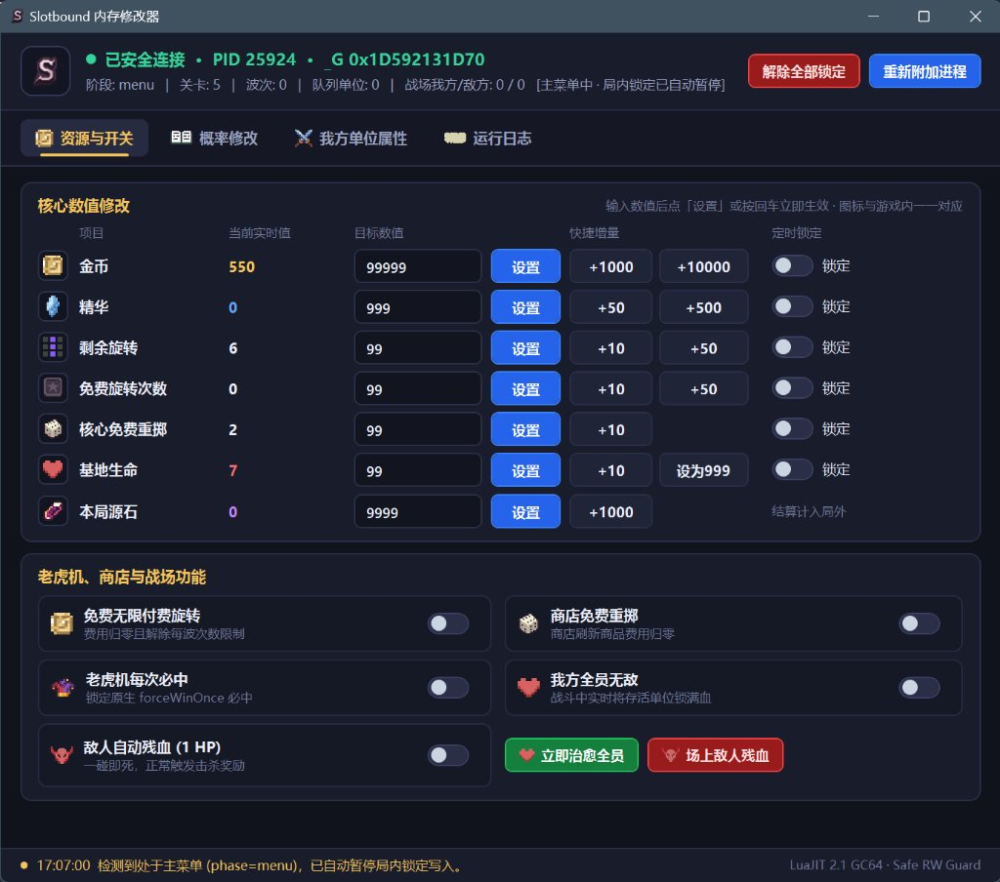

# SlotboundTrainer — Slotbound 纯内存修改器

**[简体中文](README.md) | [English](README_EN.md)**

[](LICENSE)
[](https://github.com/AppleProPlusMax/slotbound-trainer/releases)
[](#编译与运行)

面向 **Slotbound**（LÖVE 11.5 / LuaJIT 2.1 GC64 x64）的纯外部内存修改器，采用 **.NET 6 WPF** 打造暗夜鎏金现代界面，支持**一键实时中英文切换**，所有功能图标均与游戏内原版图标 1:1 对应。

## 界面预览



## 核心特点
- **100% 纯内存读写**：仅使用 Windows API（`OpenProcess` / `VirtualQueryEx` / `ReadProcessMemory` / `WriteProcessMemory`）直接解析并修改进程内存中的 LuaJIT 2.1 GC64 对象（`GCtab` / `Node` / `TValue`）。
- **绝不修改游戏文件、不注入 DLL**：不触碰 `Slotbound.dat`、`Slotbound.exe` 或任何存档文件，无 `CreateRemoteThread` / Shellcode。
- **多重内存安全防护**：
  - 写入前校验用户态地址区间与 `MEM_COMMIT | MEM_PRIVATE | PAGE_READWRITE` 内存页属性；
  - 写入前校验 LuaJIT GC64 类型标签与 NaN-boxing 数值范围，绝不破坏 GC 堆；
  - 单位修改实时重定位并校验身份，杜绝悬空指针写入；
  - 返回主菜单自动暂停局内锁定、进程断开自动解除全部锁定、概率写入拦截总和为 0 的非法输入。

## 功能一览

### 1. 资源与开关
- **核心数值修改与定时锁定**：金币（同步 UI 余额）、精华（同步 UI 余额）、剩余旋转、免费旋转次数、核心免费重掷、基地生命、本局源石
- **实用开关**：免费无限付费旋转（费用归零并解除每波次数限制，关闭自动还原）、商店免费重掷、老虎机每次必中、战斗中我方全员无敌、战斗中敌人自动残血（1 HP）
- **一键操作**：立即治愈全员 / 场上敌人一键残血

### 2. 概率修改
- **稀有度概率**：普通 / 高级 / 稀有 / 传说 / 棱彩自由配置，实时统计总和，内置「100% 传说」「100% 棱彩」「传说50%+棱彩50%」「恢复默认」预设
- **老虎机底层强制中奖概率**：支持自定义 `0% ~ 100%`（一键 100% 必中 / 归零）
- **六大职业符号权重**：W 剑 / A 弓 / S 枪 / H 骑 / M 法 / D 皇冠，定向调整流派出率，支持「六系均分」与「恢复默认」

### 3. 我方单位属性
- 实时列出队列全部单位（自动解析单位名称与品质）
- 一键全员强化（攻击 ×2 / 生命 ×2 / 攻速 ×1.5，含词条倍率与战场实体同步）
- 精准编辑单个单位：攻击力、生命值、攻速、吸收 LV、刻印槽

## 下载使用

前往 [Releases](https://github.com/AppleProPlusMax/slotbound-trainer/releases) 页面下载最新预编译版本：
- **`SlotboundTrainer-*-win-x64-standalone.zip`**（推荐）：独立自包含单文件版，解压即用，无需安装 .NET 运行时。
- **`SlotboundTrainer-*-win-x64-net6.zip`**：轻量版（需本机安装 .NET 6 Desktop Runtime）。

## 编译与运行

环境要求：Windows 10/11 x64 + [.NET 6.0 SDK](https://dotnet.microsoft.com/download/dotnet/6.0)

```powershell
dotnet build -c Release
```

编译产物位于：
```
bin\Release\net6.0-windows\SlotboundTrainer.exe
```

## 开源协议

本项目基于 [Apache License Version 2.0](LICENSE) 开源。

## 免责声明
本工具仅用于单机游戏学习与技术研究，所有游戏内图标资源版权归 Slotbound 原开发者所有。
