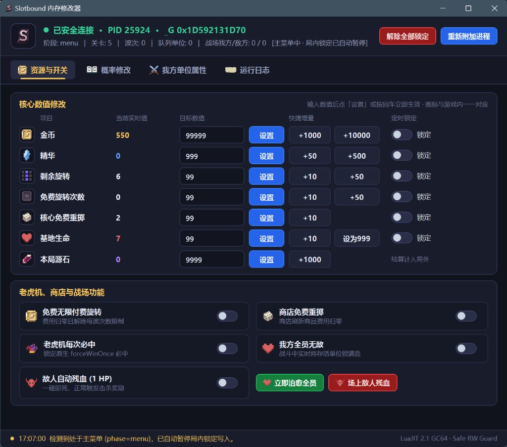

# SlotboundTrainer — Pure External Memory Trainer for Slotbound

**[English](README_EN.md) | [简体中文](README.md)**

[](LICENSE)
[](https://github.com/AppleProPlusMax/slotbound-trainer/releases)
[](#build-from-source)

A pure external memory trainer for **Slotbound** (LÖVE 11.5 / LuaJIT 2.1 GC64 x64), built with **.NET 6 WPF**. Features a modern dark-gold UI, built-in **Chinese / English live language switching**, and 1:1 native in-game pixel icons.

## Preview



## Key Highlights
- **100% Pure External Memory Access**: Uses standard Windows APIs (`OpenProcess` / `VirtualQueryEx` / `ReadProcessMemory` / `WriteProcessMemory`) to locate and update LuaJIT 2.1 GC64 runtime objects (`GCtab` / `Node` / `TValue`) directly in memory.
- **Zero File Modification & Zero DLL Injection**: Never touches `Slotbound.dat`, `Slotbound.exe`, or any save files. No `CreateRemoteThread`, no shellcode.
- **Built-in Bilingual UI (ZH / EN)**: One-click real-time language switcher (`EN` / `中文`) in the top bar.
- **Multi-Layer Memory Safety Guards**:
  - Verifies user-mode address bounds and `MEM_COMMIT | MEM_PRIVATE | PAGE_READWRITE` page protection before every write;
  - Validates LuaJIT GC64 type tags and NaN-boxing numeric ranges to protect the GC heap;
  - Re-resolves live unit pointers and verifies unit identity before writing roster edits (no stale pointer writes);
  - Automatically pauses in-run freezes in the main menu (`phase == "menu"`), clears all freezes on disconnect, and blocks invalid zero-total probability inputs.

## Features

### 1. Resources & Cheats
- **Core Values & Freeze**: Gold (synced with UI balance), Essence (synced with UI balance), Spins Left, Free Spins, Core Free Rerolls, Base HP, Run Originite
- **Cheats & Toggles**:
  - Free Unlimited Paid Spins (0 cost & removes per-wave limit; restores defaults when disabled)
  - Free Shop Reroll (0 reroll cost; restores defaults when disabled)
  - Guaranteed Slot Win (`slot.forceWinOnce`)
  - Ally God Mode (keeps living allies at full HP in battle)
  - One-Hit Enemies (1 HP, preserves normal kill rewards)
- **Instant Actions**: Heal All Allies / Set All Battlefield Enemies to 1 HP

### 2. Drop Rates (Probability Editor)
- **Rarity Drop Rates**: Customize Normal / Advanced / Rare / Legendary / Prism percentages with live total calculation and one-click presets (`100% Legendary`, `100% Prism`, `50% Leg + 50% Prism`, `Restore Default`)
- **Forced Slot Win Rate**: Adjust underlying `forceWinProb` (`0% ~ 100%`) and clear win suppression
- **Class Symbol Weights**: Tune slot weights for all 6 class symbols (`W` Sword, `A` Bow, `S` Spear, `H` Cavalry, `M` Mage, `D` Crown) with `Equalize` and `Restore Default` presets

### 3. Roster Units
- Live roster table with automatic unit name & localized grade display
- One-click bulk boosts: All ATK ×2 / All HP ×2 / All ASPD ×1.5 (synced with battlefield entities & option multipliers)
- Fine-grained editor for selected unit: ATK, HP, ASPD, Absorb LV, Imprint Slots

## Download

Get the prebuilt binaries from the [Releases](https://github.com/AppleProPlusMax/slotbound-trainer/releases) page:
- **`SlotboundTrainer-*-win-x64-standalone.zip`** *(Recommended)*: Self-contained single-file executable, no .NET runtime installation required.
- **`SlotboundTrainer-*-win-x64-net6.zip`**: Lightweight build (requires .NET 6 Desktop Runtime).

## Build from Source

Requirements: Windows 10/11 x64 + [.NET 6.0 SDK](https://dotnet.microsoft.com/download/dotnet/6.0)

```powershell
dotnet build -c Release
```

Output executable:
```
bin\Release\net6.0-windows\SlotboundTrainer.exe
```

## License

Licensed under the [Apache License, Version 2.0](LICENSE).

## Disclaimer
This tool is intended strictly for single-player learning and technical research. All in-game icon assets remain the copyright of the original Slotbound developers.
